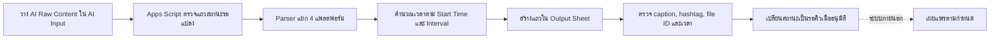

# Loongmordek Auto Sheets

Google Apps Script workflow ที่รับข้อความคอนเทนต์จาก AI หนึ่งชุด แยก caption และ hashtag สำหรับ 4 แพลตฟอร์ม แล้วสร้างแถวใน Google Sheets พร้อมสถานะตรวจทานและเวลาเผยแพร่

> สถานะ: ใช้งานเป็น Apps Script ได้หลังตั้ง Spreadsheet ID และชื่อชีตให้ตรงกับไฟล์ที่เลือก ระบบสร้างคิวข้อมูลใน Sheets เท่านั้น การโพสต์จริงเป็นขั้นตอนของระบบภายนอกและไม่ได้ทดสอบในงานปรับปรุงเอกสารนี้

## Workflow



## ไฟล์สำคัญ

| ไฟล์ | หน้าที่ |
|---|---|
| `Code.gs` | โหมดสร้าง 4 แถวทันทีในชีต `Loongmordek Content` ด้วยสถานะ `รอตรวจ` |
| `Code_due_queue.gs` | โหมด due queue ที่ทยอยปล่อยแต่ละแพลตฟอร์มลงชีต `ชีต1` ตามเวลา |
| `sample-ai-content.txt` | ตัวอย่าง input รูปแบบเต็ม |
| `sample-ai-content-simplified.txt` | ตัวอย่าง input รูปแบบหัวข้อแยกแพลตฟอร์ม |
| `test-parser.js` | ทดสอบ parser บน Node.js โดยไม่เชื่อม Google Sheets |
| `install-guide-th.txt` | คู่มือติดตั้งภาษาไทยสำหรับผู้ดูแลชีต |

เลือกใช้ `Code.gs` หรือ `Code_due_queue.gs` เพียงแบบเดียวตาม workflow ที่ต้องการ อย่านำทั้งสองไฟล์ไปรวมใน Apps Script project เดียว เพราะมีชื่อ constant และ function ซ้ำกัน

## รูปแบบข้อมูลเข้า

ในชีต `AI Input` ใช้คอลัมน์:

| คอลัมน์ | ตัวอย่างสังเคราะห์ |
|---|---|
| `Status` | `รอแปลง` |
| `AI Raw Content` | ข้อความตาม `sample-ai-content-simplified.txt` |
| `File ID` | `demo_drive_file_id` |
| `Video Name` | `ตัวอย่างคลิป Automation` |
| `Start Time` | `15/07/2026/ 10:00` |
| `Interval Minutes` | `5` |

เมื่อใช้ `Code.gs` ตัวอย่างนี้จะเตรียมเวลา:

```text
Facebook       15/07/2026 10:00
Instagram      15/07/2026 10:05
TikTok         15/07/2026 10:10
YouTube Shorts 15/07/2026 10:15
```

ข้อมูลข้างต้นเป็นตัวอย่างสังเคราะห์ ไม่ใช่ผลจากระบบ production

## ติดตั้ง `Code.gs`

1. เปิด Google Sheet ที่ต้องการใช้ และคัดลอก Spreadsheet ID จาก URL
2. เปิด **Extensions > Apps Script**
3. เปิดไฟล์ `Code.gs` ใน repository แล้วแทนค่า:

   ```javascript
   const SPREADSHEET_ID = 'PASTE_SPREADSHEET_ID_HERE';
   ```

4. คัดลอกโค้ดที่ตั้งค่าแล้วไปวางใน Apps Script และบันทึก
5. ตรวจว่ามีชีต output ชื่อ `Loongmordek Content`
6. รัน `setupAiInputSheet` หนึ่งครั้งเพื่อสร้าง/ตั้งค่าแท็บ `AI Input`
7. ตรวจชื่อโปรเจกต์และสิทธิ์ที่ Google แสดง แล้วอนุญาตเฉพาะในบัญชีที่เป็นเจ้าของชีต
8. รัน `installAutoSheetsTrigger` หนึ่งครั้ง ระบบจะสร้าง time-driven trigger ทุก 5 นาที

หากใช้ `Code_due_queue.gs` ให้ตั้ง Spreadsheet ID เช่นเดียวกัน และตรวจว่าชีต output ชื่อ `ชีต1` ตาม constant `OUTPUT_SHEET_NAME` ก่อนติดตั้ง trigger

## ขั้นตอนก่อนส่งต่อให้ระบบโพสต์

1. ตรวจ caption, hashtag, File ID และเวลาของทุกแถว
2. ตรวจว่าข้อมูลไม่มีข้อมูลส่วนบุคคลหรือข้อความที่ไม่ควรเผยแพร่
3. เปลี่ยนสถานะเป็น `รอคิว` เฉพาะแถวที่อนุมัติแล้ว
4. ทดสอบระบบปลายทางด้วยบัญชี sandbox/test ก่อนเชื่อมบัญชีจริง

## ทดสอบ Parser แบบ Offline

ต้องมี Node.js และไม่ต้องใช้ Google account:

```powershell
node test-parser.js sample-ai-content.txt
node test-parser.js sample-ai-content-simplified.txt
```

คำสั่งนี้ตรวจ logic แยก caption/hashtag เท่านั้น ไม่ได้ทดสอบ Apps Script trigger, Sheets API หรือระบบโพสต์ปลายทาง

## ข้อจำกัดที่ทราบ

- parser ต้องอาศัยหัวข้อแพลตฟอร์มในรูปแบบที่รองรับ
- ชื่อ output sheet ถูกกำหนดใน source file และต้องตรงกับชีตจริง
- trigger ทำงานเป็นรอบ จึงไม่รับประกันการประมวลผลตรงวินาที
- repository ไม่มี integration test สำหรับ Google Apps Script หรือระบบเผยแพร่ภายนอก
- Spreadsheet ID ระบุว่าใช้ชีตใด แม้ไม่ใช่ credential ก็ควรหลีกเลี่ยงการเผยแพร่ ID ของชีตจริงใน repository สาธารณะ
